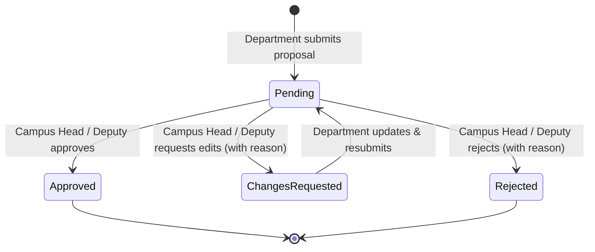

# Software Requirements Specification (SRS)

## 1. User Roles & Permissions

| Role | Scope | Key Permissions |
| :--- | :--- | :--- |
| **Campus Head** | Home Campus | Approve/reject/request changes on proposals; schedule meetings; promote/demote/move campus members; full campus read access. |
| **Deputy** | Home Campus | Same operational permissions as Campus Head for proposal reviews and meeting scheduling. |
| **Events Head** | Events Dept | Submit event proposals; create confirmed events; assign tasks to Events members; view Kanban & Gantt charts. |
| **Clubs Head** | Clubs Dept | Register new clubs; assign Club Heads; assign tasks to Clubs members. |
| **Marketing Head** | Marketing Dept | Submit marketing proposals; upload posters to events; assign tasks to Marketing members. |
| **Department Member** | Assigned Dept | View and update status of tasks assigned to them; view campus/university calendars and cross-campus event board. |

---

## 2. Proposal Approval Workflow

All proposals (Events, Clubs, and Marketing) follow a strict state machine managed by the Campus Head or Deputy:

---

## 3. Functional Requirements

### 3.1 Authentication & Role Management
| ID | Requirement | Role(s) | Priority |
| :--- | :--- | :--- | :--- |
| **FR-01** | Users authenticate using their university Microsoft account (Microsoft Entra ID OAuth 2.0). | All Users | High |
| **FR-02** | System enforces role-based and campus-based access control across all dashboards and API endpoints. | System | High |
| **FR-03** | Campus Head can promote, demote, or reassign a member's CLC department or position within their campus. | Campus Head | Medium |

### 3.2 Proposals & Leadership Approvals
| ID | Requirement | Role(s) | Priority |
| :--- | :--- | :--- | :--- |
| **FR-04** | Events department submits a proposal for a new event (title, proposed date/time, venue, description). | Events Dept | High |
| **FR-05** | Clubs department submits a proposal to register a new club and designates a Club Head. | Clubs Dept | High |
| **FR-06** | Marketing department submits a marketing proposal linked to a specific event or club. | Marketing Dept | High |
| **FR-07** | Campus Head or Deputy reviews `Pending` proposals and sets status to `Approved`, `Changes Requested`, or `Rejected`, providing a mandatory comment/reason for `Changes Requested` or `Rejected`. | Campus Head / Deputy | High |

### 3.3 Departmental Operations & Planning
| ID | Requirement | Role(s) | Priority |
| :--- | :--- | :--- | :--- |
| **FR-08** | Events department creates confirmed events on the campus calendar (linked to approved proposals or direct scheduling). | Events Dept | High |
| **FR-09** | Marketing department uploads and attaches promotional posters to scheduled events. | Marketing Dept | Medium |
| **FR-10** | Campus Head or Deputy creates campus meeting slots on the campus calendar. | Campus Head / Deputy | High |
| **FR-11** | Events Head creates and assigns operational tasks to Events department members. | Events Head | Medium |
| **FR-12** | Clubs Head creates and assigns operational tasks to Clubs department members. | Clubs Head | Medium |
| **FR-13** | Marketing Head creates and assigns operational tasks to Marketing department members. | Marketing Head | Medium |
| **FR-14** | System generates an **in-app notification** when a user is assigned a task/meeting or when their proposal status changes (no external emails). | System | Medium |
| **FR-15** | Events department views a **Kanban board** (`To Do`, `In Progress`, `Done`) ordered by priority to manage event execution. | Events Dept | Low |
| **FR-16** | Events department views a **Gantt chart** of upcoming events to identify and prevent date/venue conflicts. | Events Dept | Low |

### 3.4 Cross-Campus Visibility & Activity History
| ID | Requirement | Role(s) | Priority |
| :--- | :--- | :--- | :--- |
| **FR-17** | All users view a local campus calendar and a **university-wide calendar** displaying confirmed events across all campuses. | All Users | Medium |
| **FR-18** | All users view a **cross-campus activity board** showing confirmed event titles and details from other campuses (hiding internal tasks, member assignments, and unapproved proposals). | All Users | Low |
| **FR-19** | Department Heads and Campus Leadership can filter completed tasks and approved events by department and date range to review quarterly departmental output. | Campus / Dept Heads | Medium |

---

## 4. Non-Functional Requirements

| ID | Category | Requirement | Measurable Target |
| :--- | :--- | :--- | :--- |
| **NFR-01** | Security | All endpoints must enforce authentication and role/campus authorization checks; tokens must be validated server-side over HTTPS. | Zero unauthorized cross-role or cross-campus mutations |
| **NFR-02** | Containerization | Backend (.NET) and frontend (React) must be packaged as Docker containers with reproducible environment variables. | Clean build and startup via `Dockerfile` / Docker Compose |
| **NFR-03** | Database Uptime | Hosted PostgreSQL instance must maintain reliable availability and automated persistence. | $\ge$ 95% uptime |
| **NFR-04** | Web Uptime | Hosted web application must remain accessible during operational hours. | $\ge$ 99% availability (excluding free-tier cold starts) |
| **NFR-05** | Concurrency | System must handle simultaneous CLC users across campuses without connection pool exhaustion or data races. | Up to **50 concurrent active users** |
| **NFR-06** | Performance | Standard API queries (calendars, proposals, Kanban/Gantt data) must return promptly after service warm-up. | < 500 ms average response time |