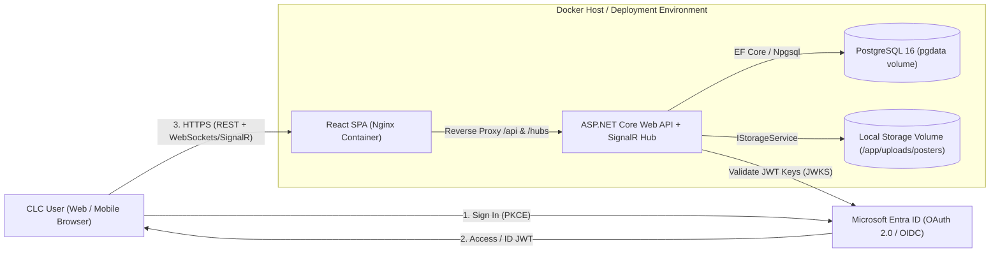
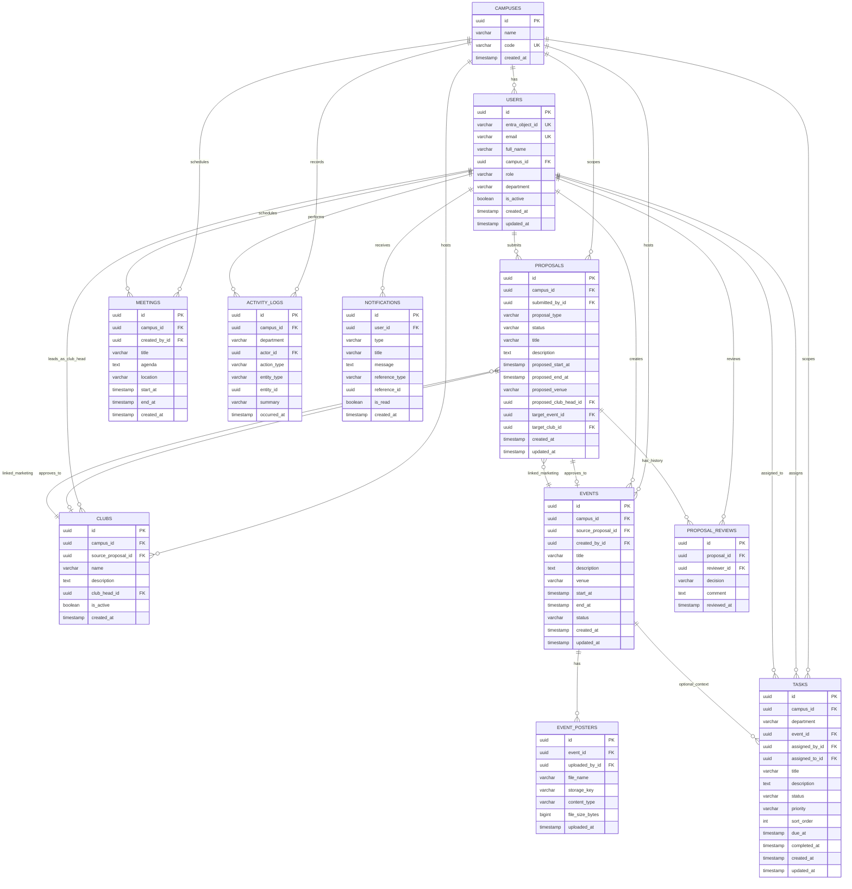
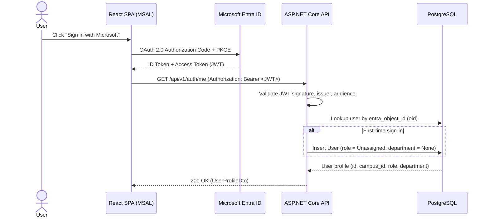
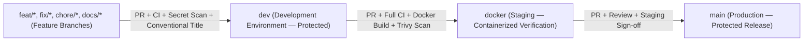

# System Design Document (SDD): CLC Operations & Departmental Platform

**Version:** 1.0  
**Date:** 24 November 2026  
**Status:** Draft  
**Related Documents:**
- [01-project_charter.md](./01-project_charter.md)
- [02-srs.md](./02-srs.md)

---

## 1. Overview & Design Goals

This document defines the technical architecture, database schema, API contracts, security model, storage abstraction, real-time notification design, UI wireframes, and Docker deployment topology for the **CLC Operations & Departmental Platform (v1.0)**.

### Core Architectural Decisions
| Area | Decision | Rationale |
| :--- | :--- | :--- |
| **Architecture Style** | Modular Monolith (ASP.NET Core Web API + React SPA) | Matches team size and soft deadline (5 Dec 2026) while keeping clear domain boundaries. |
| **Database** | PostgreSQL 16 with EF Core (Code-First Migrations) | Strong relational integrity for campus scoping, RBAC, proposals, and date-range conflict queries. |
| **Authentication** | Microsoft Entra ID (OAuth 2.0 / OIDC) via MSAL React & `Microsoft.Identity.Web` | Satisfies `FR-01` and `NFR-01` without managing local passwords. |
| **Poster Storage (`FR-09`)** | Local Docker volume behind `IStorageService` | Zero external cloud dependencies for v1.0; swappable to Azure Blob / S3 later without changing services. |
| **In-App Notifications (`FR-14`)** | ASP.NET Core SignalR + PostgreSQL persistence | Instant in-app updates while ensuring offline users retain unread notifications. |
| **Containerization (`NFR-02`)** | Docker & Docker Compose (`frontend`, `api`, `postgres`) | Reproducible local and hosted deployments with persistent volumes. |

---

## 2. System Architecture

### 2.1 High-Level Container Diagram



### 2.2 Backend Layered Architecture (ASP.NET Core)
The backend follows a clean 4-layer structure inside a single deployable Web API:
1. **Presentation Layer (`Controllers/`, `Hubs/`, `Middleware/`)**
   - REST controllers under `/api/v1/*`, SignalR `NotificationHub` at `/hubs/notifications`, global exception middleware returning RFC 7807 `ProblemDetails`.
2. **Application Layer (`Services/`, `DTOs/`, `Authorization/`)**
   - Use-case orchestration (`ProposalService`, `EventService`, `ClubService`, `TaskService`, `MeetingService`, `CalendarService`, `HistoryService`, `NotificationService`).
   - Custom ASP.NET Core authorization handlers enforcing role and home-campus boundaries.
3. **Domain Layer (`Entities/`, `Enums/`, `Exceptions/`)**
   - Strongly typed entities, proposal state-machine transition rules, and domain invariants.
4. **Infrastructure Layer (`Data/`, `Storage/`)**
   - `AppDbContext` (EF Core + Npgsql), migrations, database seeders, and `LocalVolumeStorageService : IStorageService`.

### 2.3 Frontend Architecture (React SPA)
- **Framework:** React + TypeScript + Vite.
- **Auth:** `@azure/msal-browser` and `@azure/msal-react` for Entra ID login and silent token acquisition.
- **State & Data Fetching:** TanStack Query (server state caching, optimistic Kanban updates, automatic cache invalidation) + lightweight Auth/User context.
- **Real-Time Client:** `@microsoft/signalr` connected on login to receive live notifications and trigger notification badge updates.
- **UI & Views:** Responsive layout (mobile-first sidebar/bottom nav) with dedicated Calendar, Kanban board (`@dnd-kit`), and Gantt timeline views.

---

## 3. Database Design

### 3.1 Entity-Relationship Diagram (ERD)



### 3.2 Key Schema Rules & Enumerations
- **`users.role`**: `Unassigned` (new Entra ID user awaiting Campus Head placement), `CampusHead`, `Deputy`, `EventsHead`, `ClubsHead`, `MarketingHead`, `DepartmentMember`.
- **`users.department`**: `None` (for Leadership/Unassigned), `Events`, `Clubs`, `Marketing`.
- **`proposals.proposal_type`**: `Event`, `Club`, `Marketing`.
- **`proposals.status`**: `Pending`, `Approved`, `ChangesRequested`, `Rejected`.
- **`proposal_reviews.decision`**: `Approved`, `ChangesRequested`, `Rejected` (`comment` is `NOT NULL` and non-empty when `decision` is `ChangesRequested` or `Rejected` per `FR-07`).
- **`events.status`**: `Confirmed`, `Cancelled`.
- **`tasks.status`**: `ToDo`, `InProgress`, `Done` (drives the Events Kanban board in `FR-15` and task tracking in `FR-11`–`FR-13`).
- **`tasks.priority`**: `Low`, `Medium`, `High`, `Critical`.
- **`notifications.type`**: `TaskAssigned`, `MeetingScheduled`, `ProposalApproved`, `ProposalChangesRequested`, `ProposalRejected`, `ProposalSubmitted`.

### 3.3 Indexing Strategy (Targeting < 500 ms per `NFR-06`)
| Table | Index | Purpose |
| :--- | :--- | :--- |
| `users` | `UNIQUE (entra_object_id)`, `(campus_id, department, role)` | Fast token-to-user resolution and member roster queries. |
| `proposals` | `(campus_id, status, created_at DESC)` | Leadership review queue filtering. |
| `events` | `(campus_id, start_at, end_at)`, `(status, start_at)` | Conflict detection (`FR-16`), campus calendar, and university-wide calendar (`FR-17`). |
| `tasks` | `(campus_id, department, status, priority)`, `(assigned_to_id, status)` | Kanban board ordering and member task lists. |
| `notifications` | `(user_id, is_read, created_at DESC)` | Fast unread count and notification feed loading. |
| `activity_logs` | `(campus_id, department, occurred_at DESC)` | Quarterly evaluation history filtering (`FR-19`). |

### 3.4 Proposal-to-Entity Lifecycle Rules
- **Event Proposal (`FR-04`, `FR-08`):** When a Campus Head/Deputy approves an `Event` proposal, the Events department can publish it as a confirmed `Event` (pre-filled from `source_proposal_id`), or the Events Head / Leadership may directly schedule an event on the campus calendar.
- **Club Proposal (`FR-05`):** When a `Club` proposal is set to `Approved`, the system automatically creates the `Club` record linked to `source_proposal_id` and assigns `proposed_club_head_id` as the Club Head.
- **Marketing Proposal (`FR-06`, `FR-09`):** Must reference either `target_event_id` or `target_club_id`. Once approved, Marketing uploads promotional posters (`event_posters`) linked to the target event.

---

## 4. Authentication, Onboarding & Authorization

### 4.1 Microsoft Entra ID Login Flow (`FR-01`)



### 4.2 First-Time Onboarding & Role Management (`FR-03`)
1. **Initial Seeding:** Campus records and initial `CampusHead` university emails are seeded via configuration/migration on first startup. When a seeded `CampusHead` signs in, their `entra_object_id` is bound to their pre-seeded record.
2. **New Members:** Any other university user signing in for the first time is created with `role = Unassigned`. They can view the university-wide calendar and cross-campus event board (or an "Awaiting Campus Assignment" screen) until their `CampusHead` assigns their `campus_id`, `role`, and `department` via `PATCH /api/v1/users/{id}/role`.

### 4.3 RBAC & Campus-Scoping Matrix (`FR-02`, `NFR-01`)
Every write endpoint and internal read endpoint enforces **both** role policy and a `CampusScope` check (`resource.CampusId == currentUser.CampusId`).

| Capability | Campus Head | Deputy | Events Head | Clubs Head | Marketing Head | Dept Member |
| :--- | :---: | :---: | :---: | :---: | :---: | :---: |
| Promote / Demote / Move Campus Members (`FR-03`) | Home Campus | — | — | — | — | — |
| Review Proposals (`FR-07`) | Home Campus | Home Campus | — | — | — | — |
| Schedule Campus Meetings (`FR-10`) | Home Campus | Home Campus | — | — | — | — |
| Submit Event Proposals / Publish Events (`FR-04`, `FR-08`) | Read | Read | Events Dept | — | — | — |
| Submit Club Proposals (`FR-05`) | Read | Read | — | Clubs Dept | — | — |
| Submit Marketing Proposals / Upload Posters (`FR-06`, `FR-09`) | Read | Read | — | — | Marketing Dept | — |
| Create & Assign Dept Tasks (`FR-11`–`FR-13`) | Read | Read | Events Dept | Clubs Dept | Marketing Dept | — |
| Update Own Assigned Task Status | — | — | Own Dept | Own Dept | Own Dept | Own Tasks |
| View Events Kanban & Gantt (`FR-15`, `FR-16`) | Home Campus | Home Campus | Events Dept | — | — | Events Dept |
| View Quarterly Activity History (`FR-19`) | Home Campus | Home Campus | Events Dept | Clubs Dept | Marketing Dept | — |
| View University Calendar & Cross-Campus Board (`FR-17`, `FR-18`) | All Campuses | All Campuses | All Campuses | All Campuses | All Campuses | All Campuses |

### 4.4 Cross-Campus Data Privacy Boundary (`FR-18`)
Endpoints serving cross-campus data (`/api/v1/calendar/university` and `/api/v1/cross-campus/events`) project exclusively into a restricted `PublicCampusEventDto`:
- **Included:** `eventId`, `campusName`, `title`, `description`, `venue`, `startAt`, `endAt`, `posterUrls`.
- **Strictly Excluded:** Internal `tasks`, `users`/member assignments, `meetings`, `proposals` (pending/rejected/changes requested), and `activity_logs`.

---

## 5. API Design & Contracts

### 5.1 Conventions
- **Base URL:** `/api/v1`
- **Authentication:** `Authorization: Bearer <Entra_JWT>` required on all endpoints.
- **Error Format:** RFC 7807 `application/problem+json` (`status`, `title`, `detail`, `errors`).
- **Timestamps:** ISO-8601 UTC (`2026-12-01T14:00:00Z`).

### 5.2 Endpoint Catalog

#### Auth & Users (`FR-01`–`FR-03`)
| Method | Endpoint | Roles | Description |
| :--- | :--- | :--- | :--- |
| `GET` | `/api/v1/auth/me` | Authenticated | Returns current user's profile, campus, role, and department. |
| `GET` | `/api/v1/users` | Campus Head, Deputy, Dept Heads | Lists users in the caller's campus (filterable by `department`, `role`, or `unassigned=true` for Campus Head). |
| `PATCH` | `/api/v1/users/{id}/role` | Campus Head | Promotes, demotes, or transfers a member's role/department within the campus. |

#### Proposals (`FR-04`–`FR-07`)
| Method | Endpoint | Roles | Description |
| :--- | :--- | :--- | :--- |
| `GET` | `/api/v1/proposals` | Campus Head, Deputy, Dept Heads, Dept Members (own dept) | Lists campus proposals filterable by `type` and `status`. |
| `GET` | `/api/v1/proposals/{id}` | Scoped Campus Roles | Gets proposal details including full `proposal_reviews` history. |
| `POST` | `/api/v1/proposals` | Events / Clubs / Marketing Dept | Submits a new `Event`, `Club`, or `Marketing` proposal (`status = Pending`). |
| `PUT` | `/api/v1/proposals/{id}/resubmit` | Submitter's Dept | Updates a `ChangesRequested` proposal and transitions it back to `Pending`. |
| `POST` | `/api/v1/proposals/{id}/review` | Campus Head, Deputy | Transitions `Pending` → `Approved`, `ChangesRequested`, or `Rejected` (comment mandatory for non-approved). |

#### Events, Posters & Conflict Detection (`FR-08`, `FR-09`, `FR-16`)
| Method | Endpoint | Roles | Description |
| :--- | :--- | :--- | :--- |
| `GET` | `/api/v1/events` | Scoped Campus Roles | Lists confirmed events for the caller's campus (supports `from`, `to` date filters for Gantt). |
| `POST` | `/api/v1/events` | Events Dept, Campus Head, Deputy | Creates a confirmed campus event (optionally linked to an approved `sourceProposalId`). |
| `PUT` | `/api/v1/events/{id}` | Events Head, Campus Head, Deputy | Updates event details or cancels an event. |
| `GET` | `/api/v1/events/conflicts` | Events Dept, Campus Head, Deputy | Checks overlapping confirmed/pending events by `startAt`, `endAt`, and optional `venue`. |
| `POST` | `/api/v1/events/{id}/posters` | Marketing Dept | Uploads a promotional poster (`multipart/form-data`) via `IStorageService`. |
| `DELETE` | `/api/v1/events/{id}/posters/{posterId}` | Marketing Head | Removes an attached poster from storage and DB. |

#### Clubs & Meetings (`FR-05`, `FR-10`)
| Method | Endpoint | Roles | Description |
| :--- | :--- | :--- | :--- |
| `GET` | `/api/v1/clubs` | Authenticated (Home Campus) | Lists registered clubs and assigned Club Heads. |
| `PATCH` | `/api/v1/clubs/{id}/head` | Clubs Head, Campus Head | Reassigns a Club Head for an existing club. |
| `GET` | `/api/v1/meetings` | Authenticated (Home Campus) | Lists scheduled campus meetings (`from`, `to`). |
| `POST` | `/api/v1/meetings` | Campus Head, Deputy | Schedules a campus meeting and triggers `MeetingScheduled` notifications. |
| `DELETE` | `/api/v1/meetings/{id}` | Campus Head, Deputy | Cancels a campus meeting. |

#### Tasks & Kanban (`FR-11`–`FR-13`, `FR-15`)
| Method | Endpoint | Roles | Description |
| :--- | :--- | :--- | :--- |
| `GET` | `/api/v1/tasks` | Scoped Dept / Leadership | Lists tasks filterable by `department`, `status`, `priority`, `assignedToId`, `eventId`. |
| `POST` | `/api/v1/tasks` | Events / Clubs / Marketing Head | Creates a task in the Head's department and notifies the assignee. |
| `PUT` | `/api/v1/tasks/{id}` | Dept Head (own dept) | Updates task title, description, assignee, priority, or due date. |
| `PATCH` | `/api/v1/tasks/{id}/status` | Dept Head or Assigned Member | Moves task across `ToDo` / `InProgress` / `Done` and updates `sortOrder` (logs completion to `activity_logs`). |

#### Calendars, Cross-Campus Board, History & Notifications (`FR-14`, `FR-17`–`FR-19`)
| Method | Endpoint | Roles | Description |
| :--- | :--- | :--- | :--- |
| `GET` | `/api/v1/calendar/campus` | Authenticated (Home Campus) | Combined feed of home-campus confirmed events and campus meetings. |
| `GET` | `/api/v1/calendar/university` | Authenticated (All Campuses) | University-wide confirmed events (`PublicCampusEventDto` only). |
| `GET` | `/api/v1/cross-campus/events` | Authenticated (All Campuses) | Filterable cross-campus activity board (`campusId`, `from`, `to`, `search`). |
| `GET` | `/api/v1/history` | Campus Head, Deputy, Dept Heads | Quarterly evaluation log of completed tasks & approved events (`department`, `from`, `to`). |
| `GET` | `/api/v1/notifications` | Authenticated (Own) | Paginated in-app notifications + `unreadCount`. |
| `PATCH` | `/api/v1/notifications/{id}/read` | Authenticated (Own) | Marks a single notification as read. |
| `PATCH` | `/api/v1/notifications/read-all` | Authenticated (Own) | Marks all caller notifications as read. |

### 5.3 Example Payloads

**Review Proposal (`POST /api/v1/proposals/{id}/review`)**
```json
{
  "decision": "ChangesRequested",
  "comment": "The Main Hall is booked on 12 Dec. Please shift to 14 Dec or propose Auditorium B."
}
```

**Conflict Check Response (`GET /api/v1/events/conflicts?startAt=...&endAt=...&venue=Main+Hall`)**
```json
{
  "hasConflict": true,
  "conflicts": [
    {
      "eventId": "8f14e45f-ea9a-4c31-9e12-1b8902a3b456",
      "title": "End-of-Year Tech Showcase",
      "venue": "Main Hall",
      "startAt": "2026-12-12T10:00:00Z",
      "endAt": "2026-12-12T15:00:00Z",
      "conflictType": "VenueAndTimeOverlap"
    }
  ]
}
```

---

## 6. File Storage Design (`IStorageService`)

To support promotional poster uploads (`FR-09`) with zero external infrastructure in v1.0 while keeping cloud migration trivial:

```csharp
public interface IStorageService
{
    Task<StoredFileResult> UploadAsync(Stream content, string originalFileName, string contentType, CancellationToken ct = default);
    Task DeleteAsync(string storageKey, CancellationToken ct = default);
    string GetPublicUrl(string storageKey);
}
```

### v1.0 Implementation (`LocalVolumeStorageService`)
- **Mount Path:** Container path `/app/uploads/posters` backed by Docker named volume `poster_uploads`.
- **Validation Rules:**
  - Allowed MIME types & extensions: `image/png` (`.png`), `image/jpeg` (`.jpg`, `.jpeg`), `image/webp` (`.webp`).
  - Maximum file size: **5 MB**.
  - Magic-byte header verification to prevent spoofed file uploads.
- **Naming & Serving:** Files are stored as `{campusId}/{eventId}/{uuid}.{ext}` (preventing path traversal and collisions) and served via `/uploads/posters/{storageKey}` with `Cache-Control: public, max-age=86400`.
- **Cloud Swap Path:** Implementing `AzureBlobStorageService` or `S3StorageService` only requires registering the new implementation in `Program.cs` via configuration (`Storage:Provider`).

---

## 7. Real-Time Notifications & Activity Trail

### 7.1 SignalR Hub Design (`/hubs/notifications`)
- **Authentication:** JWT passed via query string (`access_token`) on WebSocket handshake, validated by ASP.NET Core JwtBearer middleware.
- **Connection Grouping:** On `OnConnectedAsync`, the user's connection is added to group `user:{userId}`.
- **Delivery Guarantee (Persist-Then-Push):**
  1. `NotificationService.SendAsync(...)` inserts the `Notification` row into PostgreSQL first.
  2. It then invokes `IHubContext<NotificationHub>.Clients.Group($"user:{userId}").SendAsync("ReceiveNotification", dto)`.
  3. If the user is offline, the notification remains unread in PostgreSQL and is fetched on their next login via `GET /api/v1/notifications`.

### 7.2 Trigger Events
| Event | Recipient(s) | Notification Type |
| :--- | :--- | :--- |
| Proposal submitted (`FR-04`–`FR-06`) | Home Campus Head & Deputy | `ProposalSubmitted` |
| Proposal reviewed (`FR-07`) | Proposal Submitter | `ProposalApproved` / `ProposalChangesRequested` / `ProposalRejected` |
| Task assigned (`FR-11`–`FR-13`) | Assigned Department Member | `TaskAssigned` |
| Campus meeting scheduled (`FR-10`) | Home Campus Members | `MeetingScheduled` |

### 7.3 Automatic Activity Trail (`FR-19`)
Whenever a proposal is `Approved`, an event is `Confirmed`, or a task transitions to `Done`, the corresponding service writes an immutable `activity_logs` entry within the same database transaction. Department Heads and Campus Leadership query `/api/v1/history?department=...&from=...&to=...` to generate quarterly evaluation views without manual chat searches.

---

## 8. UI/UX Wireframes & Screen Map

### 8.1 Route & Navigation Map
| Route | View | Accessible Roles |
| :--- | :--- | :--- |
| `/login` | Microsoft Entra ID Sign-In | Public |
| `/dashboard` | Role-Aware Overview (My Tasks, Pending Reviews, Upcoming Events) | All Authenticated |
| `/proposals` | Proposal Pipeline & Review Queue | Leadership & Dept Roles |
| `/events` | Events List, Confirmed Events & Poster Gallery | All Campus Roles (Edit: Events/Marketing) |
| `/events/board` | Events Kanban Board (`To Do` / `In Progress` / `Done`) | Events Dept & Leadership |
| `/events/timeline` | Events Gantt Chart & Venue Conflict Detector | Events Dept & Leadership |
| `/clubs` | Club Directory & Club Head Assignments | Clubs Dept & Leadership |
| `/tasks` | Departmental Task Assignment & My Tasks | Dept Roles & Leadership |
| `/calendar` | Toggleable **Campus Calendar** / **University-Wide Calendar** | All Authenticated |
| `/cross-campus` | Cross-Campus Activity Board (Confirmed Events Only) | All Authenticated |
| `/history` | Quarterly Evaluation Activity Log (Filterable) | Campus Head, Deputy, Dept Heads |
| `/admin/members` | Campus Member Role & Department Management | Campus Head |

### 8.2 Key Screen Wireframes

#### A. Global App Shell & Leadership Proposal Queue (`/proposals`)
```text
+-----------------------------------------------------------------------------------+
| [CLC Logo]  Main Campus  |  [Search...]               [Bell (3)]  [Avatar: Head]  |
+-------------------+---------------------------------------------------------------+
|  NAVIGATION       |  PROPOSAL APPROVAL QUEUE             [Filter: All v] [Pending]|
|                   |  +---------------------------------------------------------+  |
|  * Dashboard      |  | [EVENT] Spring Hackathon 2026                [Pending]  |  |
|  > Proposals (4)  |  | Submitted by: Events Dept | Proposed: 12 Dec, Main Hall |  |
|  * Events         |  | [ Approve ]   [ Request Changes ]   [ Reject ]          |  |
|    - Kanban       |  +---------------------------------------------------------+  |
|    - Gantt        |  | [CLUB] Robotics Society                      [Pending]  |  |
|  * Clubs          |  | Submitted by: Clubs Dept | Club Head: A. Patel          |  |
|  * Tasks          |  | [ Approve ]   [ Request Changes ]   [ Reject ]          |  |
|  * Calendars      |  +---------------------------------------------------------+  |
|  * Cross-Campus   |  | [MARKETING] Hackathon Poster Campaign   [Changes Req.]  |  |
|  * History        |  | Linked Event: Spring Hackathon | Feedback: Update date  |  |
|  * Members        |  +---------------------------------------------------------+  |
+-------------------+---------------------------------------------------------------+
```

#### B. Events Kanban & Gantt Conflict View (`/events/board` & `/events/timeline`)
```text
KANBAN VIEW (Ordered by Priority)                 [+ New Task] [Filter: Priority v]
+----------------------+  +----------------------+  +----------------------+
| TO DO (3)            |  | IN PROGRESS (2)      |  | DONE (5)             |
| +------------------+ |  | +------------------+ |  | +------------------+ |
| | [HIGH] Book PA   | |  | | [CRIT] Confirm   | |  | | [MED] Draft      | |
| | Assignee: T. M.  | |  | | Venue Security   | |  | | Proposal         | |
| | Due: 28 Nov      | |  | | Assignee: S. K.  | |  | | Completed: 24 Nov| |
| +------------------+ |  | +------------------+ |  | +------------------+ |
+----------------------+  +----------------------+  +----------------------+

GANTT TIMELINE & CONFLICT DETECTOR                [Month: Dec 2026 v] [All Venues v]
Venue / Event       | 10 Dec | 11 Dec | 12 Dec | 13 Dec | 14 Dec | 15 Dec |
--------------------+--------+--------+--------+--------+--------+--------+
Main Hall           |        |        | [===Hackathon===]        |        |
Main Hall           |        |        | [!! Tech Expo !!] <-- CONFLICT    |
Auditorium B        |        | [==Club Fair==] |        |        |        |
```

#### C. University-Wide Calendar & Cross-Campus Board (`/cross-campus`)
```text
+-----------------------------------------------------------------------------------+
| CROSS-CAMPUS ACTIVITY BOARD               [Campus: All Campuses v] [Dec 2026 v]   |
| (Showing confirmed public events only — internal tasks & proposals are private)   |
+-----------------------------------------------------------------------------------+
| +-----------------------------+  +-----------------------------+                  |
| | [POSTER THUMBNAIL]          |  | [POSTER THUMBNAIL]          |                  |
| | North Campus                |  | West Campus                 |                  |
| | Annual Cultural Night       |  | Inter-Campus Debate Finals  |                  |
| | 14 Dec 2026 | 18:00         |  | 16 Dec 2026 | 14:00         |                  |
| | Venue: Student Center       |  | Venue: Lecture Hall A       |                  |
| +-----------------------------+  +-----------------------------+                  |
+-----------------------------------------------------------------------------------+
```

---

## 9. Deployment & Docker Architecture

### 9.1 Container Topology (`docker-compose.yml` Blueprint)
| Service | Image / Build | Exposed Port | Persistent Volumes | Purpose |
| :--- | :--- | :--- | :--- | :--- |
| `frontend` | Multi-stage Node 20 build → Nginx Alpine | `80` / `443` | None | Serves React static bundle and reverse-proxies `/api` and `/hubs` to `api`. |
| `api` | Multi-stage `.NET 8/9` SDK → ASP.NET Runtime | Internal `8080` | `poster_uploads:/app/uploads/posters` | Runs REST API, SignalR Hub, EF Core migrations, and poster file storage. |
| `postgres` | `postgres:16-alpine` | Internal `5432` | `pgdata:/var/lib/postgresql/data` | Primary relational database. |

### 9.2 Required Environment Variables
- **API:** `ConnectionStrings__DefaultConnection`, `AzureAd__TenantId`, `AzureAd__ClientId`, `AzureAd__Audience`, `Storage__Provider=Local`, `Storage__RootPath=/app/uploads/posters`, `Cors__AllowedOrigins`.
- **Frontend (Build-time / Runtime):** `VITE_API_BASE_URL`, `VITE_ENTRA_CLIENT_ID`, `VITE_ENTRA_TENANT_ID`, `VITE_ENTRA_REDIRECT_URI`.

### 9.3 Non-Functional Requirements Verification Matrix
| NFR | Design Mechanism |
| :--- | :--- |
| **NFR-01 (Security)** | HTTPS termination, Entra ID JWT validation, `[Authorize]` policies + `CampusScope` handler on every endpoint. |
| **NFR-02 (Containerization)** | Multi-stage `Dockerfile` for `.NET` and `React`, orchestrated with `docker-compose.yml` and `.env.example`. |
| **NFR-03 & NFR-04 (Uptime)** | Managed/hosted PostgreSQL persistence (`pgdata`), `/health` readiness endpoint on API, container restart policies (`unless-stopped`). |
| **NFR-05 (50 Concurrent Users)** | Npgsql connection pooling (default max pool size 100), stateless JWT auth, async EF Core queries, SignalR WebSockets. |
| **NFR-06 (< 500 ms Latency)** | Targeted composite PostgreSQL indexes (§3.3), `.AsNoTracking()` on read queries, DTO projection at the DB query level. |

---

## 10. Git Branching Strategy, CI/CD & Security Governance

### 10.1 Environment Branch Hierarchy
All code changes follow a strict promotion path enforced by GitHub Actions (`.github/workflows/ci.yml`) and GitHub Branch Rulesets:



- **`main` (Production):** Always deployable. Only accepts Pull Requests from `docker` (staging) or emergency `hotfix/*` branches.
- **`docker` (Staging):** Validates the containerized multi-service stack (`docker-compose.yml`, Nginx proxy, `.NET 10` API, PostgreSQL) and runs Trivy container/filesystem vulnerability scans before production release.
- **`dev` (Development Environment):** Protected integration branch. Direct pushes are disallowed; all work merges via Pull Request from typed feature branches.
- **Feature Branches (`feat/*`, `fix/*`, `chore/*`, `docs/*`, `ci/*`, `test/*`, `refactor/*`):** Short-lived branches created off `dev`, using atomic [Conventional Commits](https://www.conventionalcommits.org/).

### 10.2 Automated GitHub Workflows
| Workflow | File | Triggers | Controls Enforced |
| :--- | :--- | :--- | :--- |
| **CI & Branch Guard** | `.github/workflows/ci.yml` | PR & Push (`dev`, `docker`, `main`) | Enforces branch promotion hierarchy, `.NET 10` build/test, and `React/TypeScript` build. |
| **Security & SAST** | `.github/workflows/security.yml` | PR, Push & Weekly Schedule | Gitleaks secret scanning, NuGet & npm vulnerability audits, and CodeQL SAST (C# & TS). |
| **Docker Staging** | `.github/workflows/docker-staging.yml` | PR & Push (`docker`, `main`) | `docker compose config`, `docker compose build`, and Trivy vulnerability scan. |
| **Commit Lint** | `.github/workflows/commit-lint.yml` | Pull Requests | Validates Conventional Commit PR titles (`feat:`, `fix:`, `docs:`, `chore:`, `ci:`, `security:`). |
| **Dependabot** | `.github/dependabot.yml` | Weekly (`dev`) | Automated dependency security updates for NuGet, npm, Docker, and GitHub Actions. |

